# Omnivae — App Flow and Architecture

> Status: Architecture baseline  
> Version: 1.0  
> Last consolidated: 2026-09-08  
> Audience: AGY/coding agents, software engineers, reviewers

## 0. Architecture mandate

Omnivae is built as a **local-first, privacy-first, modular monolith with explicit ports/adapters**. It must work without a cloud account. Cloud sync, managed backend services, and broader integrations are additive layers, not assumptions baked into the domain.

The current baseline supersedes earlier exploratory stack ideas:

- **Web/PWA:** Next.js + React.
- **Mobile:** Capacitor wrappers around the shared web application where feasible.
- **Web local persistence:** IndexedDB through a storage adapter.
- **Mobile local persistence:** SQLite/local secure storage through a storage adapter.
- **Shared logic:** application/domain packages independent of platform persistence.
- **Cloud:** optional and deferred until a phase requires it.

Do not replace this stack casually. Architectural changes require an ADR and corresponding updates to this document, `schema.md`, `phases.md`, and `memory.md`.

---

## 1. Architectural principles

1. **Local-first:** local storage is authoritative for local-only operation.
2. **Offline-first UX:** offline is a supported mode, not an exceptional failure state.
3. **Profile isolation:** all personal data is scoped to a profile boundary.
4. **Ports and adapters:** domain logic does not import IndexedDB, SQLite, vendor SDKs, or cloud APIs directly.
5. **Modular monolith first:** prefer simple, well-defined internal modules over distributed services.
6. **Provider-agnostic AI:** AI capabilities depend on an internal interface, not one vendor.
7. **Controlled agents:** AI writes flow through validated domain commands and approval gates.
8. **Source records over derived state:** analytics/progress are derived from facts that can be recomputed.
9. **Stable IDs:** use UUID/ULID-class identifiers suitable for future sync.
10. **UTC internally + timezone context:** preserve correct local-day semantics while storing transport-safe timestamps.
11. **Secure secrets:** provider keys are never normal application data.
12. **Scale by evidence:** do not add microservices/Kafka/Kubernetes/sharding until actual constraints require them.

---

## 2. System context

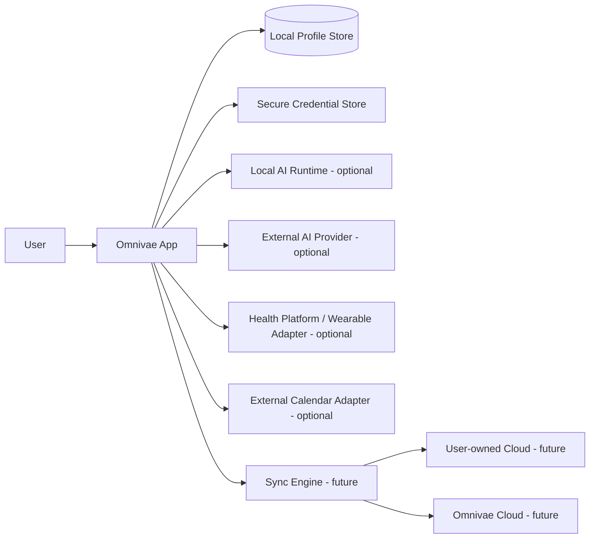

The app must retain useful functionality when every external box is unavailable.

---

## 3. High-level component architecture

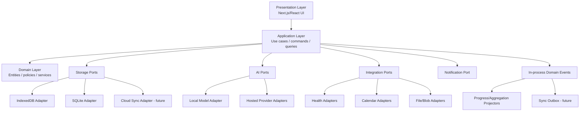

### Layer responsibilities

#### Presentation

- routing and navigation,
- forms and validation feedback,
- dashboard widgets,
- local/offline/sync state presentation,
- permission and approval UX,
- no direct persistence calls outside approved repository/query hooks.

#### Application

- orchestrates use cases,
- enforces transaction boundaries,
- performs authorization/profile-scope checks,
- validates commands,
- coordinates AI proposals and approved writes,
- emits domain events.

#### Domain

- entities/value objects,
- recurrence and scheduling rules,
- progress semantics,
- goal/task relationships,
- module rules,
- approval policy helpers,
- no framework/vendor imports.

#### Infrastructure/adapters

- IndexedDB,
- SQLite,
- secure credential APIs,
- AI provider SDK/HTTP,
- health/calendar APIs,
- file system/object storage,
- sync transport.

---

## 4. Recommended repository structure

```text
omnivae/
├── apps/
│   ├── web/                      # Next.js app/PWA
│   └── mobile/                   # Capacitor config/native shells
├── packages/
│   ├── ui/                       # shared UI primitives/design tokens
│   ├── domain/                   # pure business entities/policies
│   ├── application/              # commands, queries, use cases
│   ├── storage/                  # storage ports + common repository contracts
│   ├── storage-indexeddb/        # web adapter
│   ├── storage-sqlite/           # mobile adapter
│   ├── crypto/                   # approved crypto/key abstractions
│   ├── ai/                       # provider-neutral AI contracts/orchestration
│   ├── ai-providers/             # optional provider adapters
│   ├── integrations/             # health/calendar/notifications ports
│   ├── sync/                     # outbox/conflict logic; later phases
│   ├── analytics/                # aggregation/projection logic
│   ├── config/                   # typed config and feature flags
│   └── test-support/             # factories/fixtures/harnesses
├── docs/
│   ├── prd.md
│   ├── architecture.md
│   ├── rules.md
│   ├── phases.md
│   ├── schema.md
│   ├── memory.md
│   └── testing.md
├── tests/
│   ├── integration/
│   ├── e2e/
│   ├── security/
│   └── fixtures/
└── README.md
```

Package names may be adjusted to workspace conventions, but boundaries must remain explicit.

---

## 5. App launch and profile flow

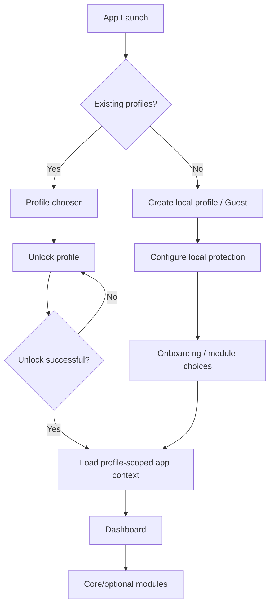

### Profile boundary

At runtime, the application obtains an explicit `ProfileContext` after successful local unlock. All profile-owned repositories require that context or derive it from an authenticated local session object.

Never design APIs like:

```ts
getTask(taskId)
```

when they can bypass scope. Prefer contracts conceptually equivalent to:

```ts
getTask(profileContext, taskId)
```

or repositories already constructed for a specific profile session.

The underlying store should still include `profile_id` constraints so isolation is enforced at more than one layer.

---

## 6. Navigation/app flow

A default navigation model may expose:

```text
Dashboard
Calendar
Tasks
Goals
Notes
AI
More / Modules
  ├── Journal
  ├── Health
  ├── Study
  ├── Gym
  ├── Habits
  ├── Projects
  └── Files
Settings
```

Navigation is configuration-driven. Disabled optional modules must be removed or clearly inactive, not left as broken routes.

Tablet/desktop layouts may use persistent side navigation. Mobile may use bottom navigation for a small set of primary destinations plus a module launcher.

---

## 7. Module architecture

Each module should expose a small internal API and own its domain/application logic.

Example:

```text
Tasks Module
├── domain
│   ├── Task
│   ├── TaskStatus
│   └── TaskRecurrencePolicy
├── application
│   ├── CreateTask
│   ├── UpdateTask
│   ├── CompleteTask
│   └── QueryTasks
├── ports
│   └── TaskRepository
└── presentation
    ├── task-list
    └── task-editor
```

Cross-module integration must use stable domain references, application services, or domain events. Avoid one module reaching directly into another module's database tables from UI code.

---

## 8. Core domain relationships

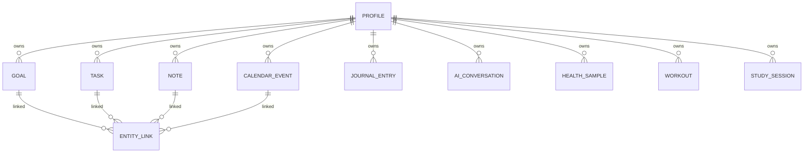

Use explicit link entities for flexible cross-module relationships where a strict foreign key would create excessive coupling. Use direct foreign keys when ownership is unambiguous and stable.

---

## 9. Storage abstraction

### Contract

Business/application logic must depend on repository/storage interfaces.

```text
Application use case
      ↓
Repository interface
      ↓
Storage unit-of-work / transaction abstraction
      ↓
IndexedDB adapter OR SQLite adapter
```

### Required storage capabilities

- profile-scoped CRUD,
- transactions or equivalent atomic groups,
- indexed queries by profile/time/status,
- schema version/migration support,
- soft-delete/tombstone support where sync requires it,
- change capture/outbox hook for future sync,
- attachment metadata references,
- deterministic test adapter/in-memory implementation where useful.

### Do not

- scatter raw IndexedDB calls through React components,
- import SQLite libraries into domain code,
- let cloud sync become the only repository implementation,
- use browser `localStorage` for sensitive or structured primary data.

---

## 10. Local database responsibilities

The local database stores personal domain records, not raw secret keys.

Stored locally:

- profile metadata that is safe to persist,
- tasks/calendar/goals/notes,
- journal/reflection,
- module records,
- AI conversations and memory according to user settings,
- integration metadata,
- local health/workout/study history,
- dashboard configuration,
- audit/provenance metadata as appropriate,
- sync metadata when enabled.

Stored in secure credential storage:

- AI API keys,
- OAuth refresh/access credentials where possible,
- encryption key material or wrapped keys according to the security design.

---

## 11. Local security architecture

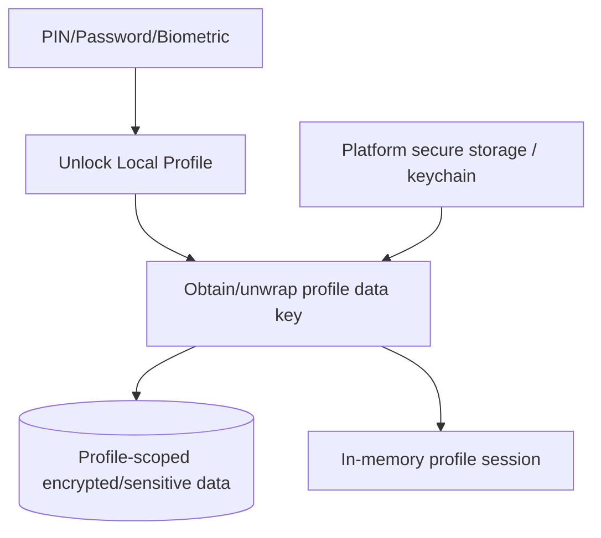

### Rules

- Never implement custom cryptographic primitives.
- PIN/password must not be stored directly.
- Password-derived keys require an approved KDF with appropriate parameters.
- Biometrics should unlock protected key material through platform-supported APIs; biometric templates themselves are never handled by Omnivae.
- Lock/timeout behavior must clear sensitive in-memory state according to platform capabilities.

Exact algorithms/libraries require an explicit security decision before production hardening.

---

## 12. Time architecture

Store absolute timestamps in UTC/ISO or a robust native timestamp representation and preserve timezone information where local-date semantics matter.

Important distinctions:

- `created_at`: absolute instant,
- `due_at`: optional absolute instant,
- `scheduled_local_date`: may be needed for all-day/local-day semantics,
- `timezone`: IANA timezone when a schedule is timezone-bound,
- recurring templates: must define whether recurrence follows local wall-clock time.

Do not calculate week/month/year progress with naive UTC date truncation. Aggregation uses the profile's configured timezone unless the record has a domain-specific timezone.

---

## 13. Calendar architecture

### Event model

Calendar events support:

- one-time timed events,
- all-day events,
- recurrence in later phases,
- local source,
- external source reference,
- template/provenance metadata,
- links to other entities.

### Bulk schedule copy flow

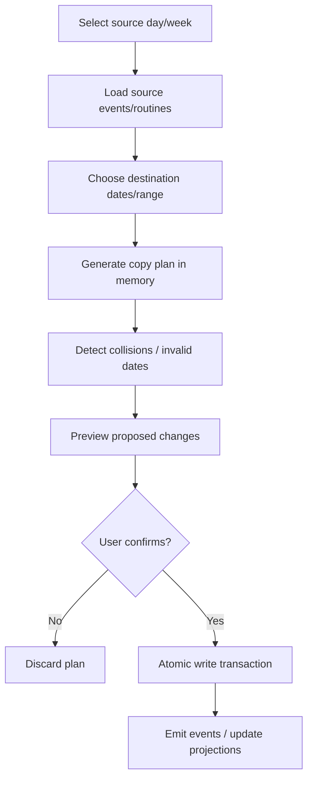

The copy engine should work on normalized schedule items and date transforms rather than UI clones.

### Bulk operation identity

Records created by one copy/apply action should optionally carry a `bulk_operation_id` or provenance reference. This enables:

- undo where feasible,
- debugging,
- conflict inspection,
- test assertions.

---

## 14. Notes-to-action architecture


AI extraction may prefill fields later, but it must still flow through the same validated form/command path unless the user has explicitly approved an agent proposal.

---

## 15. Progress/analytics architecture

### Source of truth

```text
Task completions
Habit completions
Study sessions
Workout sessions/sets
Health samples
Goal evidence
Calendar/activity events
        ↓
Normalization
        ↓
Daily projections
        ↓
Weekly/monthly/yearly aggregation
```

Do not maintain independent manually-mutated counters as the only truth.

### Projection strategy

Early phases may compute on query for small datasets. As volume grows, introduce cached aggregate tables/materialized projections that are:

- versioned,
- invalidatable,
- rebuildable from source records,
- profile/timezone aware.

---

## 16. AI architecture

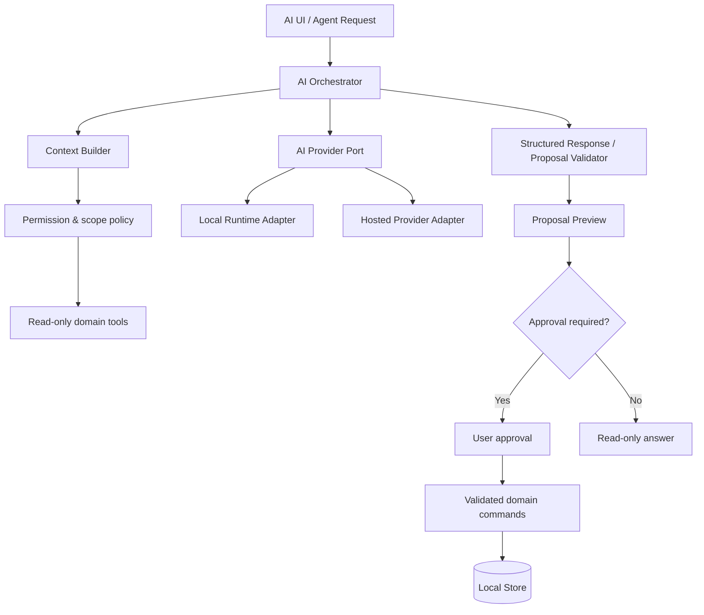

### AI Provider Port

Conceptual capabilities:

```ts
interface AIProvider {
  validateConfiguration(...): Promise<ValidationResult>
  generateText(...): Promise<AIResponse>
  streamText?(...): AsyncIterable<AIChunk>
  supportsStructuredOutput(): boolean
  capabilities(): ProviderCapabilities
}
```

Provider-specific message formats must be translated at the adapter boundary.

### Context builder

The context builder must:

- use current profile only,
- obey module/memory/history permissions,
- include only data required for the task,
- tag provenance where useful,
- avoid sending secrets,
- avoid sending health/private context unless explicitly enabled for that request or policy.

---

## 17. AI conversation and memory architecture

Raw chats and durable memory are separate concepts.

```text
Conversation
├── messages
├── model/provider metadata
└── optional references

Memory
├── structured fact/preference/context
├── provenance
├── confidence/state
├── created/updated timestamps
└── retention/deletion state
```

A user may clear chats without necessarily clearing explicitly retained memory and vice versa, if the product UI offers both. The storage model must not make those operations impossible.

Memory retrieval is never cross-profile.

---

## 18. Agent tool architecture

Agents do not get direct repository handles.

Expose narrow tools such as:

```text
read_tasks(filter)
read_calendar(range)
read_goals(status)
read_reflections(range, permission)
propose_tasks(...)
propose_calendar_changes(...)
apply_approved_proposal(proposal_id, approval_token)
```

### Proposal object

A proposal should contain:

- proposal ID,
- profile ID internally,
- requested intent,
- proposed operations,
- affected entities/date ranges,
- conflicts/warnings,
- human-readable explanation,
- creation/expiry timestamps,
- approval state,
- model/provider provenance.

Writes should be executed from validated proposal data, not by reparsing uncontrolled prose after approval.

---

## 19. Nightly reflection architecture

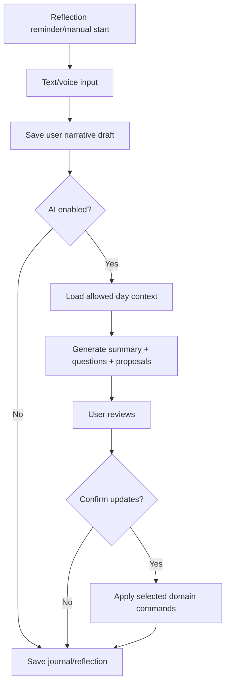

User-authored narrative and AI summary are stored separately. This preserves provenance and prevents the model from rewriting history.

---

## 20. Health architecture

Prefer a normalized health domain over vendor-specific fields.

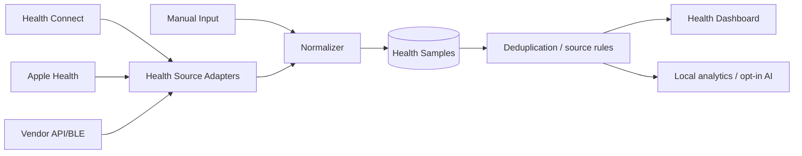

### Health sample normalization

Common normalized fields:

- metric type,
- numeric/value payload,
- unit,
- start/end timestamp,
- source/provider,
- source record ID,
- device metadata if permitted,
- quality/confidence metadata if available.

Do not coerce incompatible vendor concepts into false equivalence.

### Import safety

- track source IDs to avoid duplicates,
- preserve original source metadata,
- support revocation/disconnect behavior,
- never infer a metric that the source did not provide,
- do not upload health history to an AI provider by default.

---

## 21. Files/attachments architecture

Store binary files behind a file/blob abstraction.

```text
FileMetadata
  ├── id
  ├── profile_id
  ├── storage_provider
  ├── storage_locator
  ├── mime_type
  ├── size
  ├── checksum (when appropriate)
  └── lifecycle state
```

Domain entities reference metadata IDs. The UI must not assume every attachment is a web URL.

Web may use browser storage APIs; mobile may use app-private filesystem storage. Future cloud sync can map the same metadata to object storage.

---

## 22. Integration architecture

All external integrations use adapters with explicit capability boundaries.

### Calendar port

Conceptual operations:

- list external calendars,
- request authorization,
- pull events for a range,
- map external event IDs,
- push approved writes only where supported,
- revoke/disconnect.

### Health port

- request permissions for selected metric types,
- query changed records/ranges,
- normalize source data,
- store source cursors/tokens safely,
- revoke/disconnect.

### Notification port

- request permission,
- schedule local notification,
- cancel local notification,
- list app-owned schedules where supported.

---

## 23. Sync architecture — future

Sync is intentionally a later layer.

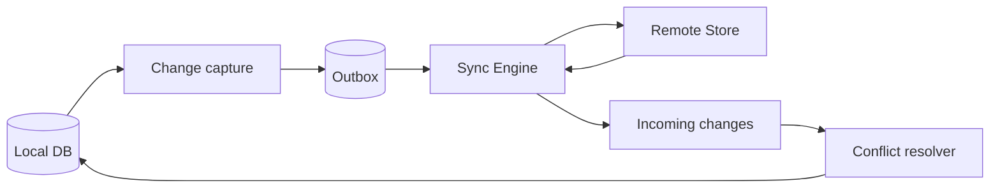

### Required sync metadata

At minimum, synced entities need semantics for:

- stable global/local ID,
- version or revision,
- `updated_at`,
- deleted/tombstone state,
- origin/device ID where useful,
- sync state,
- remote revision token if provider exposes one.

### Conflict strategy

Do not default every entity to last-write-wins without analysis.

Possible per-entity policies:

- immutable event append/merge,
- field-level merge,
- explicit conflict UI,
- server-authoritative metadata,
- latest-write for low-risk preferences.

Conflict policies must be documented in `schema.md`/ADR before sync ships.

---

## 24. Optional cloud architecture

When managed cloud is introduced:

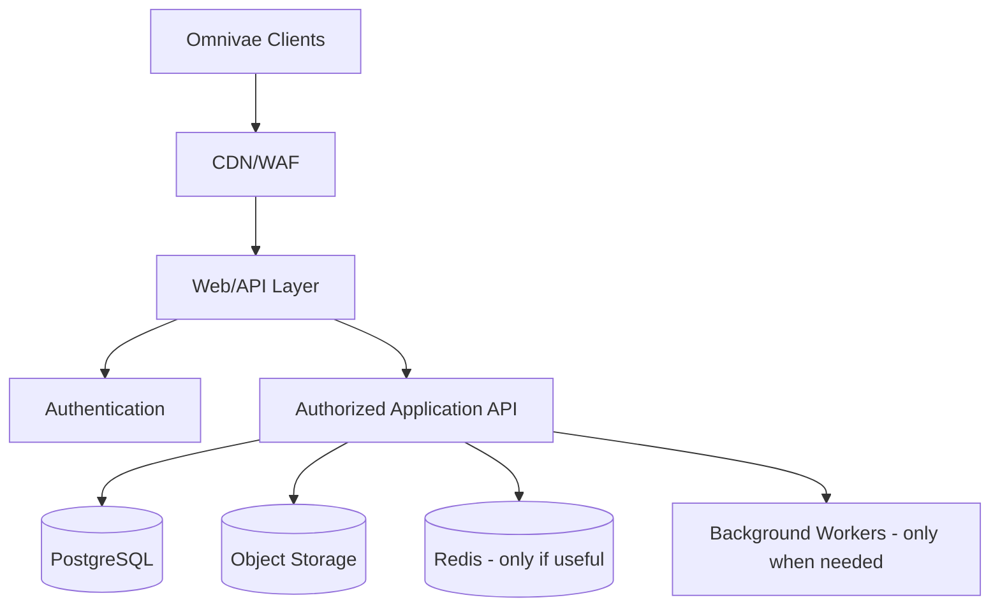

Security requirements:

- authenticated session determines user identity,
- never trust client-provided owner IDs,
- row/user authorization on every protected operation,
- RLS where suitable,
- secure secret management,
- rate limits/abuse controls,
- backups and tested restore procedures,
- export/deletion support,
- audit logs for security-relevant actions.

---

## 25. Data ownership modes

### Mode A — Local only

```text
Device → local profile → encrypted/protected local data
```

No managed Omnivae account required.

### Mode B — User-owned cloud/backup

```text
Local data → encrypted export/sync package → user's chosen storage
```

This requires a format/versioning design before implementation.

### Mode C — Managed Omnivae cloud

```text
Local-first client ↔ authenticated sync API ↔ managed data services
```

Managed cloud must not erase local-first semantics.

---

## 26. Error and resilience architecture

Every external action must have a typed failure path.

Examples:

- AI provider unavailable,
- API key invalid,
- permission revoked,
- health source partially unavailable,
- calendar write rejected,
- local storage quota exceeded,
- migration failed,
- sync conflict,
- offline state.

Rules:

- never silently discard user input,
- use local drafts for long-form input where practical,
- transactions roll back partial bulk writes,
- retry only idempotent/safely retryable operations,
- surface recovery actions to the user.

---

## 27. Observability

Local-first does not mean no diagnostics. It means diagnostics must respect privacy.

Allowed patterns:

- local structured logs with redaction,
- crash/error reports only with clear privacy controls if remote telemetry is later added,
- performance metrics without message contents/secrets,
- correlation IDs that are not secret identifiers.

Never log:

- API keys,
- passwords/PINs,
- encryption keys,
- raw health payloads by default,
- raw journal/AI conversation content by default,
- full OAuth tokens.

---

## 28. Feature flags and migrations

Use typed feature flags for incomplete/incremental capabilities. A flag must not be used to hide failing required functionality in a release declared complete.

Database migrations must be:

- versioned,
- deterministic,
- covered by upgrade tests,
- reversible where practical or accompanied by a safe forward-only recovery path,
- tested against representative older fixtures.

Never delete user data in a migration without an explicit product/data migration decision.

---

## 29. Testing seams

Architecture must make the following easy to test:

- domain rules without a browser,
- application use cases against in-memory/fake repositories,
- identical repository conformance tests against IndexedDB and SQLite,
- AI orchestration with fake providers,
- agent approval without live LLM calls,
- health/calendar adapters with fixtures,
- offline flows,
- migration upgrades,
- profile isolation,
- bulk calendar operations atomically.

If a design makes these impractical, revisit the design before implementation.

---

## 30. Key sequence diagrams

### 30.1 Create task offline

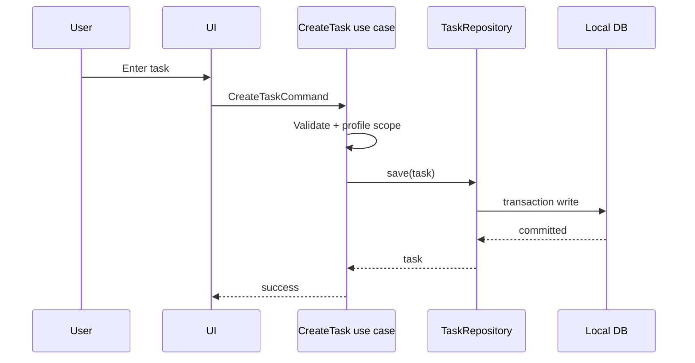

### 30.2 AI proposes a schedule

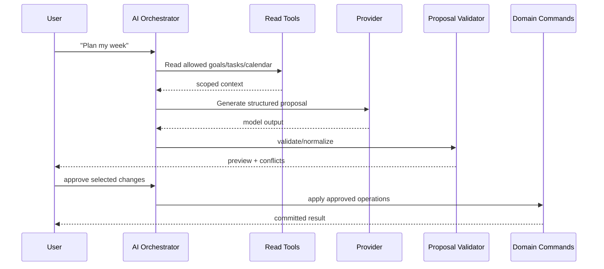

### 30.3 Cross-profile access rejection

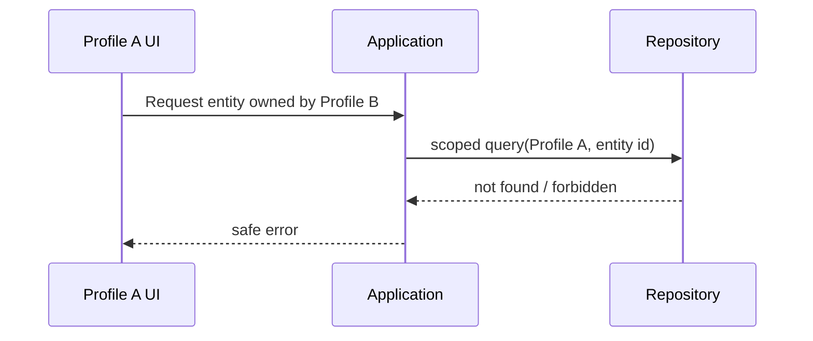

---

## 31. Architecture decisions already locked

These are the current baseline:

- Product name: **Omnivae**.
- Product category: personal intelligence / life operating system.
- Local-first and privacy-first.
- Multiple isolated local profiles.
- Job/Career is optional.
- Provider-agnostic BYOK AI.
- AI chat local by default.
- Explicit chat deletion/history controls.
- Controlled agents; preview/approval before consequential writes.
- Storage abstraction between domain logic and platform database.
- Next.js + React web/PWA baseline.
- Capacitor mobile wrapper baseline.
- IndexedDB web adapter.
- SQLite mobile adapter.
- Modular monolith initially.
- Optional future sync/cloud.
- Stable IDs for sync readiness.
- UTC/robust timestamps plus timezone-aware local semantics.
- Progress intelligence is the long-term AI differentiator.

---

## 32. Architecture decisions still open

Do not guess these in production code:

- exact monorepo tooling,
- exact client state/query library,
- exact IndexedDB wrapper,
- exact SQLite library/plugin,
- exact local encryption implementation,
- exact secure-storage plugin,
- exact rich-text editor,
- exact charting library,
- exact recurrence library,
- exact AI provider list for first release,
- exact health integration order,
- exact cloud vendor/backend framework,
- exact sync conflict policy per entity,
- exact object storage layout,
- exact local search/indexing engine.

For low-risk library choices needed to proceed, an agent may choose a mature dependency consistent with `rules.md`, document it in `memory.md`, and add an ADR when it meaningfully constrains architecture.

---

## 33. Forbidden architecture shortcuts

Do not:

- use one global unscoped user-data repository,
- store API keys in `localStorage`, source, logs, URLs, or analytics,
- call external AI directly from every feature,
- let an LLM execute SQL or arbitrary repository mutations,
- couple domain types to provider response schemas,
- make cloud availability required for local CRUD,
- mark AI-generated progress as fact without evidence/user confirmation,
- duplicate daily/weekly/monthly/yearly tracking tables as separate truths,
- add microservices just to look scalable,
- implement custom crypto,
- silently change architectural decisions while coding.

---

## 34. Architecture completion checklist

Before a feature is considered architecture-compliant, verify:

- [ ] Domain/application logic is not tied to a platform database.
- [ ] Every personal record is profile-scoped.
- [ ] Offline/local behavior is defined.
- [ ] Secret handling is explicit.
- [ ] Cross-module relationships use approved interfaces/references.
- [ ] AI context and writes follow permission/approval rules.
- [ ] New source records support future aggregation/sync where relevant.
- [ ] Failure behavior is defined.
- [ ] Tests can exercise the feature without a live external service.
- [ ] Required tests in `testing.md` pass.

The checkbox may only be marked after the corresponding test evidence exists.

## AI implementation decision — 2026-10-04

Hosted adapters receive prompt/context and an abort signal, never storage handles. Provider output is strictly parsed into an allowlisted command shape, then normalized and domain-validated before encrypted proposal storage. Approval binds exact SHA-256/version and checks all scoped source revisions before a single transaction. Follow-up revisions invalidate prior approvals. Unsupported destructive commands fail closed. All writes and generated task history are part of the previewed proposal. Full product controls/memory/voice/on-device remain required.

## 2026-10-06 — Standalone inference decision
Native LiteRT-LM 0.17.1 is added behind the AIProvider port. Public imported weights are device-shared; each request uses a fresh native conversation, with no storage/tool access. User data stays in profile-scoped encrypted application services. Android on-device speech recognition and offline-only TTS are separate capabilities, explicitly unavailable when absent. No cloud fallback. See docs/offline-ai.md for constraints and pending gates.
