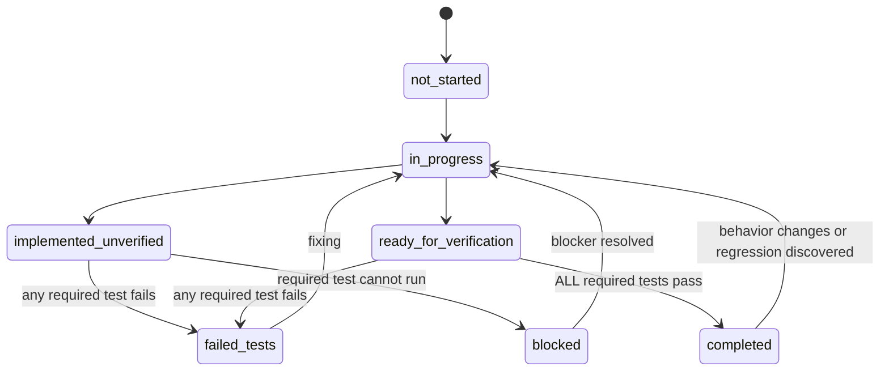

# Omnivae — Feature Testing and Completion Contract

> Status: Binding QA/completion source of truth  
> Version: 1.0  
> Last consolidated: 2026-09-08  
> Audience: AGY/coding agents, QA, reviewers

# 0. Absolute completion rule

**NEVER mark a task, subtask, feature, bug, refactor, migration, phase, or release as completed unless ALL test cases required for that scope pass.**

There is no “mostly complete” exception.

If implementation exists but one required test fails, the correct status is:

- `failed_tests`, or
- `implemented_unverified` if the test cannot yet be executed.

If a required test is skipped, quarantined, disabled, or blocked, the work is **not completed**.

A visual check alone is not sufficient when automated or reproducible tests are required.

---

# 1. Purpose

This document defines:

- test layers,
- required test categories,
- feature-specific test cases,
- phase gates,
- regression expectations,
- evidence required before completion,
- rules for failed/flaky/blocked tests.

AGY must use this document as a completion state machine, not merely as a testing suggestion list.

---

# 2. Status state machine



### Rule

`completed` is a **test-derived state**, not an agent opinion.

---

# 3. Test layers

## 3.1 Static checks

Examples:

- TypeScript typecheck,
- lint,
- formatting/check where enforced,
- dependency/security checks where configured,
- secret scan,
- schema validation.

Static checks are required for every code-bearing completion gate unless the repository explicitly does not use one of them.

## 3.2 Unit tests

Test pure logic:

- domain policies,
- date transforms,
- recurrence calculations,
- progress aggregation,
- validators,
- AI proposal validation,
- health unit normalization,
- dedupe fingerprints,
- permission logic.

Unit tests should avoid live network calls.

## 3.3 Repository/adapter conformance tests

Run the same behavior suite against:

- in-memory/reference adapter if used,
- IndexedDB adapter,
- SQLite adapter when available.

The purpose is to prove storage adapters preserve the same application contract.

## 3.4 Integration tests

Test interactions between real internal components:

- application use case + repository,
- migration + populated store,
- bulk transaction + persistence,
- AI orchestrator + fake provider + proposal validator,
- integration adapter + fixture payload,
- file metadata + blob lifecycle.

## 3.5 E2E tests

Test user-visible workflows through the actual UI/runtime:

- onboarding/profile unlock,
- task CRUD,
- note conversion,
- schedule copy,
- AI proposal approval,
- nightly reflection,
- module toggles,
- deletion/history controls.

Use real local storage adapter for the target where feasible.

## 3.6 Security/privacy tests

Required for sensitive boundaries:

- cross-profile access,
- secret leakage,
- approval bypass,
- health permission scope,
- export isolation,
- cloud authorization in future.

## 3.7 Offline/resilience tests

Required for local-first core features:

- network disabled,
- provider failure,
- app reload,
- storage failure/transaction rollback where feasible,
- interrupted sync in future.

## 3.8 Migration tests

Every schema migration must be verified against:

- clean install,
- previous schema with no data,
- previous schema with representative data,
- multiple profiles when profile tables are involved,
- deleted/archived records where relevant.

---

# 4. Test ID convention

Use stable IDs in docs/issues/test names where practical:

```text
<AREA>-<NUMBER>
```

Examples:

- `PROF-001`
- `TASK-004`
- `CAL-BULK-012`
- `AI-APPROVAL-007`
- `HEALTH-IMPORT-009`
- `SEC-ISOLATION-003`

When adding a feature, add its new required cases here or in a linked feature-specific test section before marking it complete.

---

# 5. Universal tests required for every personal-data feature

Every new profile-owned module/entity must satisfy these where applicable.

## U-001 — Profile ownership on create

**Given** Profile A is active  
**When** A creates a record  
**Then** the stored record is owned by A.

## U-002 — Cross-profile read rejection

**Given** a record belongs to A  
**When** Profile B requests the record by ID  
**Then** B receives safe not-found/forbidden behavior and no private fields.

## U-003 — Cross-profile update rejection

B cannot mutate A's record by guessing/providing its ID.

## U-004 — Cross-profile delete rejection

B cannot delete A's record.

## U-005 — Offline local create/read

With network unavailable, local CRUD expected for the feature succeeds.

## U-006 — Persistence after reload/restart

A successfully committed local record remains after supported app reload/restart.

## U-007 — Validation failure does not corrupt data

Invalid input returns a validation state and does not partially write an invalid record.

## U-008 — Deletion semantics

Delete/archive/soft-delete behavior matches `schema.md` and linked records remain correct.

## U-009 — Migration preservation

If the feature participates in a migration, representative existing records remain readable and correct after upgrade.

## U-010 — No secret/private diagnostic leakage

Errors/logs do not contain forbidden secret material or raw private content beyond approved debug/test fixtures.

A feature cannot be completed while an applicable universal test fails.

---

# 6. Foundation gate — P0-GATE-FOUNDATION

Required cases:

### FND-001 — Workspace install

Dependency install completes reproducibly using the documented package manager/lockfile.

### FND-002 — Web build

Production web build succeeds.

### FND-003 — Typecheck

Typecheck exits successfully.

### FND-004 — Lint

Lint exits successfully with no blocking violations.

### FND-005 — Unit runner

Unit test runner executes a smoke test and returns pass.

### FND-006 — E2E runner

E2E harness can open the app and verify root/app shell.

### FND-007 — Route/navigation smoke

Primary shell route renders and navigation does not crash.

### FND-008 — Domain dependency boundary

Automated dependency rule or review verifies pure domain package does not import React/Next.js/IndexedDB/SQLite/provider SDKs.

### FND-009 — No committed real secrets

Secret scanner or equivalent reproducible check passes.

### FND-010 — Offline app shell

After PWA/app-shell installation/cache setup exists, core shell can launch offline according to phase expectations.

**Gate passes only if FND-001 through FND-010 applicable to the repository all pass.**

---

# 7. Profile and storage gate — P1-GATE-PROFILE-STORAGE

## Profile tests

### PROF-001 — Create local profile without email

A user can create a valid local profile without cloud registration/email.

### PROF-002 — Create two profiles

Two profiles can coexist with distinct IDs/settings.

### PROF-003 — Correct credential unlock

Correct PIN/password verifier unlocks the intended profile.

### PROF-004 — Incorrect credential rejected

Incorrect credential does not unlock or reveal protected data.

### PROF-005 — Lock clears active access

After lock/logout, protected repositories cannot be queried through stale UI/session state.

### PROF-006 — Guest behavior explicit

Guest retention behavior matches the defined product decision and is communicated/tested.

### PROF-007 — Settings isolated

Changing Profile A settings does not change Profile B settings.

## Storage tests

### STORE-001 — IndexedDB repository conformance

All implemented repository contract tests pass against IndexedDB.

### STORE-002 — SQLite repository conformance

All implemented repository contract tests pass against SQLite once adapter exists.

### STORE-003 — Transaction atomicity

A multi-write application transaction either fully commits or preserves documented rollback behavior.

### STORE-004 — Stable IDs

Created entities receive valid opaque stable IDs and collisions are not observed in deterministic test scope.

### STORE-005 — Schema version

New DB records current schema version correctly.

### STORE-006 — Empty migration

Fresh/empty DB migrates successfully.

### STORE-007 — Populated migration

Representative previous-version data migrates without loss.

## Isolation security tests

### SEC-ISOLATION-001 — Direct ID read

B cannot read A record by ID.

### SEC-ISOLATION-002 — List query

B's list query never returns A records.

### SEC-ISOLATION-003 — Search

Search results are profile-scoped.

### SEC-ISOLATION-004 — Export

Profile export includes only selected profile.

### SEC-ISOLATION-005 — Cache/projection

Cached data from A is not displayed after switching to B.

### SEC-ISOLATION-006 — Attachment lookup

B cannot resolve A's file metadata/storage locator.

### SEC-ISOLATION-007 — AI context

When AI layer later exists, B context retrieval excludes A completely.

**P1 cannot be marked completed until all currently applicable PROF/STORE/SEC-ISOLATION cases pass.**

---

# 8. Tasks tests

### TASK-001 — Create task offline

Create with required fields while network is disabled.

### TASK-002 — Edit task

Change title/details and persist across reload.

### TASK-003 — Complete task

Status becomes completed and `completed_at` is set consistently.

### TASK-004 — Reopen task

Reopen clears/updates completion state according to schema policy.

### TASK-005 — Cancel task

Cancelled is distinguishable from completed.

### TASK-006 — Due date is not completion

Passing due time does not mark task complete.

### TASK-007 — Scheduled range validation

Invalid end-before-start input is rejected unless explicitly supported semantics apply.

### TASK-008 — Goal link

Task can link to same-profile goal.

### TASK-009 — Cross-profile goal link rejected

Task in A cannot link to goal in B.

### TASK-010 — Source note provenance

Task created from note preserves source reference.

### TASK-011 — Delete source note

Deleting source note follows documented link behavior and does not silently delete independent task.

### TASK-012 — List/status filters

Pending/completed/cancelled filters return correct records only for active profile.

---

# 9. Goals tests

### GOAL-001 — Create/edit/archive goal

CRUD and status behavior persists.

### GOAL-002 — Parent/child hierarchy

Valid hierarchy works.

### GOAL-003 — Cycle prevention

Goal cannot become its own ancestor.

### GOAL-004 — Milestone completion

Milestone status/completion timestamp persists.

### GOAL-005 — Evidence link

Same-profile source evidence links successfully.

### GOAL-006 — Cross-profile evidence rejected

Cross-profile evidence link fails.

### GOAL-007 — AI cannot fabricate progress

AI-generated proposed progress is not committed without source/user approval.

### GOAL-008 — Recalculation

Derived progress changes correctly when source evidence is edited/deleted.

---

# 10. Notes tests

### NOTE-001 — Create/edit/delete offline

Basic local flow works offline.

### NOTE-002 — Search

Text search finds expected same-profile note and excludes other profiles.

### NOTE-003 — Convert note to task

Pre-filled task is reviewable, saves, and links to source note.

### NOTE-004 — Convert note to event

Calendar event is created after validation and links to note.

### NOTE-005 — Convert note to goal

Goal conversion preserves source.

### NOTE-006 — Conversion does not delete note

Source remains unless user separately deletes it.

### NOTE-007 — AI extraction requires review

If AI extracts fields, ambiguous/structured output is not silently committed without applicable approval/review.

### NOTE-008 — Attachment link

Attached file metadata is same-profile and survives note edit.

---

# 11. Basic calendar tests

### CAL-001 — Timed event CRUD

Create/edit/delete timed local event.

### CAL-002 — All-day event

All-day event uses correct local date semantics.

### CAL-003 — Timezone display

Stored event renders correctly in profile timezone.

### CAL-004 — Cross-midnight event

Event spanning midnight preserves start/end.

### CAL-005 — Month/year boundary

Event at boundary appears in correct views.

### CAL-006 — Leap day

Valid leap-day date works; invalid date rejected.

### CAL-007 — Linked task/note

Same-profile entity link works.

### CAL-008 — Offline calendar CRUD

Local calendar remains fully usable offline.

### CAL-009 — Source attribution

Imported/template/AI-approved events retain source type/ref.

---

# 12. Core planning gate — P2-GATE-CORE-PLANNING

Pass requirements:

- all applicable universal tests,
- TASK-001..012,
- GOAL-001..008,
- NOTE-001..008,
- CAL-001..009,
- profile isolation suite,
- migration suite for introduced stores,
- static checks,
- E2E smoke flows for Task, Note conversion, Event creation.

One failure blocks P2 completion.

---

# 13. Dashboard and module tests

### DASH-001 — Layout persists

Reorder widgets, reload, same order remains.

### DASH-002 — Layout profile isolation

A and B have independent layouts.

### DASH-003 — Disable widget

Disabled widget no longer renders in applicable layout.

### DASH-004 — Disable module

Disabled optional module disappears from navigation/dashboard and its stored data is not deleted.

### DASH-005 — Re-enable module

Re-enabling restores access to existing data.

### DASH-006 — Career optional

Core onboarding/use works with Career disabled.

### DASH-007 — Offline render

Dashboard reads local data offline without unnecessary network dependency.

### DASH-008 — Time filter

Day/week/month/year filter changes projection only, not source records.

### DASH-009 — Empty state

No-data dashboard renders useful empty state without exceptions.

---

# 14. Progress aggregation tests

### PROG-001 — Daily task completion count

Matches source completion records in profile timezone.

### PROG-002 — Weekly aggregation

Equals sum/defined aggregation of relevant daily source data.

### PROG-003 — Monthly aggregation

Correct across varying month lengths.

### PROG-004 — Yearly aggregation

Correct across year boundary.

### PROG-005 — Edit source

Editing source invalidates/rebuilds affected aggregate.

### PROG-006 — Delete source

Deleting source removes its contribution after recompute.

### PROG-007 — Timezone day boundary

Record near UTC midnight belongs to correct profile-local day.

### PROG-008 — DST boundary

For DST zones, local day/week grouping remains correct.

### PROG-009 — No separate truth mutation

Updating a projection/cache does not create fake source completion records.

### PROG-010 — Study duration aggregation

Later, study source durations aggregate correctly.

### PROG-011 — Workout aggregation

Later, workout source data aggregates correctly.

### PROG-012 — Health aggregation source attribution

Later, health summaries remain traceable/rebuildable from imported samples.

---

# 15. Dashboard/progress gate — P3-GATE-DASHBOARD-PROGRESS

Pass:

- DASH-001..009,
- PROG-001..009 minimum plus relevant module cases,
- universal/profile isolation tests,
- static checks,
- offline E2E dashboard flow.

---

# 16. Habits tests

### HABIT-001 — Create recurrence

Habit recurrence saves/loads correctly.

### HABIT-002 — Completion record

Completing habit creates a source completion record.

### HABIT-003 — Streak derived

Streak derives from completions, not only a manually mutated counter.

### HABIT-004 — Delete completion

Streak recalculates correctly after removing a completion.

### HABIT-005 — Pause

Paused habit does not incorrectly count required completions.

### HABIT-006 — Timezone recurrence

Daily habit uses correct profile local date.

### HABIT-007 — Cross-profile isolation

Completion/query cannot leak across profiles.

---

# 17. Study tests

### STUDY-001 — Create topic/session

Records persist locally.

### STUDY-002 — Actual duration

Duration derives correctly from actual timestamps.

### STUDY-003 — Planned vs actual distinct

Planned duration does not become actual progress automatically.

### STUDY-004 — Goal/skill linkage

Same-profile link works.

### STUDY-005 — Aggregation

Daily/weekly study time equals recorded actual sessions.

### STUDY-006 — Edit session

Projection updates after duration edit.

---

# 18. Gym tests

### GYM-001 — Workout session CRUD

Workout persists.

### GYM-002 — Exercise order

Exercise ordering persists.

### GYM-003 — Set data

Reps/load/duration values validate and persist.

### GYM-004 — Units

kg/lb or distance units behave according to defined conversion/display policy.

### GYM-005 — Workout completion/aggregation

Workout frequency/volume summaries match source sets/sessions.

### GYM-006 — Imported duplicate prevention

When health integration later imports same workout, documented dedupe/link policy prevents uncontrolled duplicate counts.

---

# 19. Journal/reflection manual tests

### JOURNAL-001 — Create/edit reflection offline

User narrative persists with network disabled.

### JOURNAL-002 — Narrative preserved

Later AI summary cannot overwrite original user narrative field.

### JOURNAL-003 — Date grouping

Entry appears on correct profile-local date.

### JOURNAL-004 — Delete semantics

Deletion behaves as documented and linked AI output no longer appears incorrectly.

---

# 20. Files tests

### FILE-001 — Add metadata + blob

File can be stored through abstraction and metadata resolves.

### FILE-002 — Profile isolation

B cannot resolve A's file locator/blob.

### FILE-003 — Multiple links

One file can link to multiple same-profile entities without binary duplication if implementation supports it.

### FILE-004 — Delete one link

Removing a relationship does not delete shared file while another link exists, unless lifecycle policy explicitly says otherwise.

### FILE-005 — Delete file

File deletion removes/invalidates blob safely and handles links according to policy.

### FILE-006 — Storage failure

Failed blob write does not leave a misleading successful attachment record or vice versa; reconciliation path is tested.

---

# 21. Life modules gate — P4-GATE-LIFE-MODULES

Pass all applicable:

- HABIT-001..007,
- STUDY-001..006,
- GYM-001..005,
- JOURNAL-001..004,
- FILE-001..006,
- universal/profile isolation cases,
- progress aggregation cases for these modules,
- migrations,
- static checks,
- E2E smoke flows.

---

# 22. Calendar bulk copy/template tests

This suite is critical.

## Day copy

### CAL-BULK-001 — Copy day to one day

All eligible source schedule items produce expected destination plan.

### CAL-BULK-002 — Source remains unchanged

Copy operation never mutates source event dates/times.

### CAL-BULK-003 — Paste to multiple days

One source day can map to multiple selected destination dates without ID collisions.

### CAL-BULK-004 — Same-day destination

System handles source == destination according to documented policy (reject/no-op/explicit duplicate) consistently.

## Week copy

### CAL-BULK-005 — Copy week to another week

Day offsets and local wall-clock times are preserved according to timezone policy.

### CAL-BULK-006 — Weekend pattern

Separate weekend schedule remains selectable/applicable without replacing weekdays unexpectedly.

### CAL-BULK-007 — Multiple future weeks

Applying across selected weeks creates correct number of planned items.

## Date edge cases

### CAL-BULK-008 — End of month

Date transform handles month boundary.

### CAL-BULK-009 — End of year

Date transform handles year boundary.

### CAL-BULK-010 — Leap day

Correct in leap year and defined behavior when target year lacks Feb 29.

### CAL-BULK-011 — DST spring transition

Wall-clock preservation follows documented timezone policy.

### CAL-BULK-012 — DST fall transition

Ambiguous/repeated local times are handled deterministically.

### CAL-BULK-013 — Cross-midnight event

Duration/relative schedule stays valid.

### CAL-BULK-014 — All-day event

All-day local dates shift correctly.

## Conflict/preview

### CAL-BULK-015 — Detect conflict

Existing destination events are detected under documented conflict definition.

### CAL-BULK-016 — Preview exactness

Preview operations equal committed operations after approval; no hidden extra writes.

### CAL-BULK-017 — Cancel preview

Cancel results in zero schedule writes.

### CAL-BULK-018 — Resolve/accept conflict policy

User selection maps to exact expected writes.

## Atomicity/provenance

### CAL-BULK-019 — Atomic commit failure

Injected failure during commit leaves no undocumented half-applied schedule.

### CAL-BULK-020 — Bulk operation provenance

Created records share correct `bulk_operation_id`/source.

### CAL-BULK-021 — Idempotent retry policy

If a bulk operation is retried after an ambiguous failure, it does not create uncontrolled duplicates according to implementation design.

## Templates

### CAL-BULK-022 — Save day template

Template persists source-independent structure.

### CAL-BULK-023 — Save week template

Template items preserve day offsets/times.

### CAL-BULK-024 — Apply template

Template application creates editable ordinary events/records according to product contract.

### CAL-BULK-025 — Edit template after prior application

Changing template does not silently mutate previously applied events unless explicitly designed and confirmed.

### CAL-BULK-026 — Delete template

Deleting template does not silently delete already created schedule records.

### P5-GATE-CALENDAR-BULK

All CAL-BULK-001..026 applicable to shipped scope must pass. If the phase claims full day/week/template behavior, **all 26 are mandatory**.

---

# 23. AI provider/BYOK chat tests

## Provider abstraction

### AI-PROV-001 — Fake provider conformance

Provider interface can return deterministic response/stream/error.

### AI-PROV-002 — Provider-specific error mapping

Invalid auth/rate limit/network errors map to safe product errors.

### AI-PROV-003 — Provider objects do not leak into domain

Dependency/typing test or review verifies domain remains provider-neutral.

### AI-PROV-004 — Local provider seam

Local runtime adapter can be selected/configured when implemented without changing domain contracts.

## Secret tests

### AI-SEC-001 — Key not in normal DB

Configured API key is absent from ordinary app tables/stores.

### AI-SEC-002 — Key not in logs

Test instrumentation verifies key is redacted/never logged during validate/request/error.

### AI-SEC-003 — Key not in URL

Provider requests never place key in query-string unless a provider strictly requires it and security review explicitly approves; default expected behavior is header/secure mechanism.

### AI-SEC-004 — Profile-scoped credential ref

B cannot use/read A's provider credential configuration.

## Chat history tests

### AI-CHAT-001 — Send/receive stores messages when history enabled

Conversation persists locally.

### AI-CHAT-002 — Offline history view

Existing chats open while network is unavailable.

### AI-CHAT-003 — Disable history

Behavior matches defined policy: new messages are not durably retained beyond necessary session state.

### AI-CHAT-004 — Delete one chat

Selected conversation/messages become unavailable.

### AI-CHAT-005 — Delete all chats

All profile chat history is removed/hidden according to deletion policy and other profiles remain unchanged.

### AI-CHAT-006 — Export chats

Export contains selected profile only and no API key.

### AI-CHAT-007 — Provider failure preserves user input

A failed request does not silently lose the user's prompt/draft according to UX policy.

### AI-CHAT-008 — External processing disclosure

E2E/UI test verifies disclosure is shown in the relevant provider setup/use flow.

### P6-GATE-AI-CHAT

Pass AI-PROV-001..004 applicable, AI-SEC-001..004, AI-CHAT-001..008, isolation/static checks, and provider integration smoke where environment credentials are intentionally available.

Live-provider credentials are never required for unit completion; use fake/provider-contract tests. A release claiming a specific provider works must also pass its controlled integration smoke.

---

# 24. AI memory tests

### AI-MEM-001 — Memory profile isolation

A memory is never returned in B retrieval.

### AI-MEM-002 — Capture enabled

Eligible confirmed memory can be stored according to policy.

### AI-MEM-003 — Capture disabled

No new durable active memory is created while disabled.

### AI-MEM-004 — Delete one memory

Deleted memory disappears from user view/retrieval immediately.

### AI-MEM-005 — Clear all memory

All active memory for the profile is excluded from retrieval; other profiles unchanged.

### AI-MEM-006 — Chats vs memory independent

Clearing chats does not incorrectly preserve hidden chat-only retrieval; clearing memory does not necessarily delete raw chat if user did not request it, according to product behavior.

### AI-MEM-007 — Provenance

Stored memory has expected source/user-confirmation metadata.

### AI-MEM-008 — Expiry

Expired temporary memory is not retrieved.

### AI-MEM-009 — Deleted source

Policy for memory derived from deleted source is applied and tested.

### AI-MEM-010 — External context minimization

Context builder sends only selected/relevant memory scope in fixture test.

---

# 25. AI controlled-tool/proposal tests

## Read tools

### AI-TOOL-001 — Read tasks scoped

Returns only active profile + allowed filters.

### AI-TOOL-002 — Read calendar scoped

Returns only requested range/profile.

### AI-TOOL-003 — Read reflection permission

Reflection/journal content is excluded when permission/policy says no.

### AI-TOOL-004 — Health access off

Health context is not returned to AI context builder when off.

## Proposal validation

### AI-APPROVAL-001 — Proposal structured schema validation

Malformed operation is rejected.

### AI-APPROVAL-002 — Invalid entity reference rejected

Cross-profile/nonexistent target cannot be proposed for executable mutation.

### AI-APPROVAL-003 — Preview contains all operations

No hidden write exists outside previewed plan.

### AI-APPROVAL-004 — No approval, no write

Pending/rejected proposal produces zero domain mutation.

### AI-APPROVAL-005 — Correct approval commits

Exact approved proposal commits expected records.

### AI-APPROVAL-006 — Version/hash mismatch

Approval for old proposal version/hash cannot apply changed plan.

### AI-APPROVAL-007 — Partial approval

If supported, only selected operations commit.

### AI-APPROVAL-008 — Destructive confirmation

Delete/destructive op cannot apply without stronger explicit confirmation flag/flow.

### AI-APPROVAL-009 — Atomic multi-write

Injected failure rolls back whole atomic proposal unless partial semantics are explicit and approved.

### AI-APPROVAL-010 — Provider prose cannot bypass validator

Free-form model text alone cannot trigger write path.

### AI-APPROVAL-011 — Proposal expiry

Expired proposal cannot be applied without regeneration/reapproval.

### AI-APPROVAL-012 — Cross-profile approval token misuse

Approval from A cannot apply proposal for B.

### P7-GATE-AI-CONTROL

Pass AI-MEM-001..010, AI-TOOL-001..004, AI-APPROVAL-001..012, isolation/static/security suites.

---

# 26. Nightly reflection tests

## Manual reflection

### REFL-001 — Start manually

User can create reflection without scheduled notification.

### REFL-002 — Scheduled reminder

When enabled, local notification/reminder schedule matches configured local time.

### REFL-003 — AI optional

Reflection can be saved with AI disabled/unavailable.

### REFL-004 — User narrative preserved

Raw user narrative remains unchanged after AI summary generation.

## AI reflection

### REFL-005 — Summary provenance

AI summary stored separately with model/provider metadata when available.

### REFL-006 — Follow-up question

AI follow-up can be represented without modifying source narrative.

### REFL-007 — Proposed updates only

AI-detected task/progress/schedule changes stay pending until confirmation.

### REFL-008 — Rejected suggestion no mutation

Rejecting an update makes no domain write.

### REFL-009 — Confirmed update exactness

Confirmed selected updates produce exact expected source records/state transitions.

### REFL-010 — No fabricated completion

If narrative does not confirm task completion, AI cannot mark it complete solely from inference.

### REFL-011 — Contextual missed task

Missed task remains missed/pending/cancelled according to explicit user/plan state; system does not auto-complete it.

### REFL-012 — Adaptive schedule proposal

Reschedule suggestion is a proposal and does not commit before approval.

### REFL-013 — Avoid cascading overload

Fixture/scenario verifies planner respects configured constraints and does not blindly stack all missed work into next available slot/day.

## Canonical scenario

### REFL-SCENARIO-001 — Family interruption scenario

**Planned:** gym, coding, reading.  
**User says:** family situation occurred; gym skipped; read for one hour; coding status provided/unknown per fixture.  
**Expected:**

- narrative saved,
- gym not marked complete,
- reading update only becomes source fact after user confirmation or explicit structured input,
- AI may propose rescheduling remaining work,
- no hidden write,
- no shaming/failure score inserted as fact.

### P8-GATE-REFLECTION

Pass REFL-001..013 and REFL-SCENARIO-001 plus AI approval/security suites.

---

# 27. Health core tests

## Metric model

### HEALTH-CORE-001 — Manual metric entry

Supported manually entered metric validates and persists.

### HEALTH-CORE-002 — Unit validation

Unsupported/incompatible units rejected.

### HEALTH-CORE-003 — Unit conversion

Approved conversion math matches fixtures/known values.

### HEALTH-CORE-004 — Source attribution

Every sample has a source.

### HEALTH-CORE-005 — Time range query

Metric query returns correct range/profile.

### HEALTH-CORE-006 — Daily summary rebuild

Cached summary can be recomputed from samples.

### HEALTH-CORE-007 — Edit/delete source sample

Summary updates accordingly.

### HEALTH-CORE-008 — No missing metric fabrication

Dashboard displays unavailable/empty rather than invented value.

### HEALTH-CORE-009 — AI health access off

No health sample is included in external AI context when access is off.

### HEALTH-CORE-010 — Per-request health AI scope

Only selected metric/time range is included when user grants narrow access.

### HEALTH-CORE-011 — Profile isolation

All health records remain profile-scoped.

### HEALTH-CORE-012 — Offline dashboard

Imported/manual history remains viewable offline.

### P9-GATE-HEALTH-CORE

Pass HEALTH-CORE-001..012 plus static/isolation/migration tests.

---

# 28. Health integration tests

Run per provider/source adapter.

### HEALTH-IMPORT-001 — Permission grant

Granted scopes are represented accurately.

### HEALTH-IMPORT-002 — Permission denial

Denial does not crash and no unauthorized query occurs.

### HEALTH-IMPORT-003 — Partial permission

Only granted metric types are imported.

### HEALTH-IMPORT-004 — Normalize metric

Fixture provider payload maps to correct normalized metric/unit/timestamps.

### HEALTH-IMPORT-005 — Preserve source ID

External source record ID is stored when supplied.

### HEALTH-IMPORT-006 — Duplicate import

Importing same external record twice does not double count.

### HEALTH-IMPORT-007 — Changed external record

Update semantics match provider capabilities and do not create an uncontrolled duplicate.

### HEALTH-IMPORT-008 — Source conflict

Two providers reporting similar metrics remain distinguishable and dashboard merge rule is deterministic.

### HEALTH-IMPORT-009 — Revoked permission

Subsequent unauthorized import stops safely.

### HEALTH-IMPORT-010 — Disconnect

Disconnect removes credentials/access state according to policy but does not silently destroy already imported local history unless user chooses deletion.

### HEALTH-IMPORT-011 — Cursor/range continuation

Incremental import does not skip or repeat records outside documented overlap/dedupe logic.

### HEALTH-IMPORT-012 — Timezone/source timestamp

Imported timestamps preserve correct instant/local interpretation.

### HEALTH-IMPORT-013 — Large import

Representative high-volume fixture completes without unacceptable memory/performance behavior.

### HEALTH-IMPORT-014 — No raw health logging

Logs do not contain fixture raw payload beyond test harness-controlled assertions.

### P10-GATE-HEALTH-INTEGRATION

For each claimed integration, pass HEALTH-IMPORT-001..014 applicable plus HEALTH-CORE suite.

---

# 29. External calendar integration tests

### CAL-EXT-001 — Authorization grant

Integration enters connected state.

### CAL-EXT-002 — Authorization denial

Local calendar remains usable; no external query occurs.

### CAL-EXT-003 — List calendars

Only accessible calendars appear.

### CAL-EXT-004 — Import event mapping

External event maps to correct local normalized event.

### CAL-EXT-005 — Duplicate prevention

Repeated import of same external event does not duplicate.

### CAL-EXT-006 — External update

Updated provider event maps according to revision policy.

### CAL-EXT-007 — External delete

Delete/tombstone behavior matches documented policy.

### CAL-EXT-008 — Read-only calendar

App does not attempt unauthorized writes.

### CAL-EXT-009 — Approved outbound write

If write supported, user-approved operation creates/updates exactly intended provider event.

### CAL-EXT-010 — Agent external write approval

AI cannot write external calendar without explicit approval.

### CAL-EXT-011 — Offline cached view

Previously imported events remain readable offline.

### CAL-EXT-012 — Disconnect

Credentials are revoked/removed according to adapter design and local records behave according to policy.

### P11-GATE-CALENDAR-INTEGRATION

Pass CAL-EXT-001..012 applicable plus core calendar and secret tests.

---

# 30. Voice/rich notes/stylus test families

Add concrete tests when implementation is chosen.

Minimum categories:

## Voice

- permission denial,
- recording start/stop,
- interrupted recording,
- transcription failure preserves audio/draft according to policy,
- transcript review before structured action,
- no accidental external upload without disclosure.

## Rich notes

- serialization round trip,
- paste/sanitize unsafe HTML if applicable,
- attachments,
- export,
- migration from plain text/markdown.

## Stylus/drawing

- stroke persistence,
- undo/redo,
- viewport/resize behavior,
- file export/linking,
- performance on tablet-size canvas.

No subfeature is complete until its full defined test set is added here and passes.

---

# 31. User-owned sync gate — P13-GATE-USER-SYNC

## Outbox

### SYNC-001 — Local change enqueued

Syncable local mutation produces expected outbox/change record.

### SYNC-002 — Idempotent retry

Retry does not duplicate remote record.

### SYNC-003 — Offline queue

Changes accumulate offline and transmit later.

## Incoming changes

### SYNC-004 — Remote new record

Imports into correct profile.

### SYNC-005 — Remote update

Applies under documented revision policy.

### SYNC-006 — Remote deletion

Tombstone/delete propagates safely.

## Conflict

### SYNC-007 — Conflict detection

Concurrent incompatible edits create conflict state rather than silent corruption.

### SYNC-008 — Conflict resolution

Chosen policy produces deterministic final result.

### SYNC-009 — Resolution persistence

Resolved conflict does not reappear on next sync without new conflict.

## Deletion safety

### SYNC-010 — Deleted record not resurrected

Old remote/local copy cannot resurrect a user-deleted record after tombstone rules are satisfied.

## Backup/restore

### SYNC-011 — Export/backup round trip

Representative profile data restores equivalently.

### SYNC-012 — Wrong key/corrupt backup

Fails safely without partial corrupt restore.

### SYNC-013 — Versioned backup migration

Older supported backup imports through documented migration path.

## Isolation

### SYNC-014 — Profile/account mix-up rejected

Remote payload for wrong profile/account cannot be imported as another owner.

### SYNC-015 — Attachment sync consistency

Metadata/blob states remain consistent under interrupted upload/download.

Pass all required SYNC-001..015 before P13 completion.

---

# 32. Managed cloud gate — P14-GATE-MANAGED-CLOUD

In addition to sync tests:

### CLOUD-AUTH-001 — Unauthenticated request rejected

Protected API cannot be used without valid auth.

### CLOUD-AUTH-002 — Client user ID spoof rejected

Authenticated User A cannot supply User B ID and access B records.

### CLOUD-AUTH-003 — Row/account isolation

Queries return only authenticated account's allowed data.

### CLOUD-AUTH-004 — Object/file authorization

Object storage access is scoped and signed/authorized appropriately.

### CLOUD-AUTH-005 — Rate limiting/abuse control

Configured sensitive endpoints enforce documented limits.

### CLOUD-AUTH-006 — Token revocation/session expiry

Revoked/expired credentials stop access.

### CLOUD-DATA-001 — Encryption/TLS config review

Deployment checks confirm protected network transport and approved at-rest controls.

### CLOUD-DATA-002 — Backup restore test

A backup is actually restored into an isolated environment and validated.

### CLOUD-DATA-003 — Account export

Export contains only user-owned data and excludes secrets.

### CLOUD-DATA-004 — Account deletion

Deletion/tombstone/purge behavior matches policy and does not reappear through sync.

### CLOUD-AUDIT-001 — Security audit events

Relevant auth/admin/security actions produce safe audit records without secrets.

P14 cannot complete without a documented security review in addition to automated tests.

---

# 33. Progress intelligence gate — P15-GATE-PROGRESS-INTELLIGENCE

Advanced AI must be evaluated on correctness and guardrails, not only “good-looking output.”

### INTEL-001 — Goal context grounded

Planner references actual stored user-approved goal fixture.

### INTEL-002 — Evidence-grounded progress

Skill/goal progress references stored evidence and does not invent achievements.

### INTEL-003 — Missing data uncertainty

When evidence is absent, output expresses uncertainty rather than false certainty.

### INTEL-004 — Schedule conflict avoidance

Planner proposal does not knowingly overlap hard calendar constraints unless surfaced as conflict.

### INTEL-005 — Workload constraint

Planner respects configured capacity/rest constraints in fixtures.

### INTEL-006 — Reflection adaptation

Recent confirmed reflection context changes proposal in expected way without rewriting historical facts.

### INTEL-007 — Disabled module exclusion

If Career/Gym/etc. is disabled or unauthorized, agent does not rely on hidden module data.

### INTEL-008 — Local/cloud policy

Context routing respects selected model/privacy policy.

### INTEL-009 — Approval required

Advanced plan still cannot commit consequential changes without approval.

### INTEL-010 — Deterministic structural validation

Even if natural-language content varies, proposal schema/constraints are validated deterministically.

### INTEL-011 — Adversarial prompt/tool injection

Untrusted note/file content cannot instruct the agent to bypass tool permissions/approval in tested scenarios.

### INTEL-012 — Destructive request guard

Destructive operations follow explicit confirmation regardless of model recommendation.

Pass all applicable deterministic guardrail tests and the selected evaluation suite before P15 completion.

---

# 34. Security regression suite

Run for any release touching auth, storage, AI, files, sync, or integrations.

Minimum suite:

- `SEC-ISOLATION-*`
- API key secret tests,
- approval bypass tests,
- export profile-scope test,
- attachment access test,
- health permission tests if health changed,
- cloud authorization tests if cloud changed.

Add automated checks for:

- XSS/sanitization where rich content exists,
- CSRF/session security where server mutations exist,
- unsafe URL schemes in links/attachments,
- path traversal in file adapters,
- SQL/query injection in server/storage layers,
- dependency vulnerabilities according to release policy.

---

# 35. Offline regression suite

Run for changes touching core local modules/storage/service worker/mobile shell.

Required user flows:

1. launch/unlock local profile offline,
2. dashboard renders local data,
3. create/edit/complete task,
4. create/edit note,
5. create/edit local calendar event,
6. journal entry save,
7. study/workout/habit save if modules shipped,
8. existing AI chat history view,
9. local AI works if configured,
10. external-only actions show unavailable/queued state rather than false success.

---

# 36. Migration regression suite

For every release with schema changes:

- fresh latest DB,
- upgrade from immediately previous release,
- upgrade from oldest supported release/fixture,
- multiple profiles,
- representative records from all touched modules,
- deleted/archived records,
- AI history/memory if schema changed,
- file metadata if schema changed,
- failure recovery behavior.

A successful fresh install does **not** prove migration completion.

---

# 37. Accessibility regression suite

At least for core flows changed:

- keyboard reachability,
- visible focus,
- labels/accessible names,
- modal/dialog focus management,
- destructive confirmation semantics,
- no status conveyed by color alone,
- mobile touch targets,
- responsive no-horizontal-overflow where not intentional.

Automated accessibility tools are useful but do not replace manual smoke checks for important flows.

---

# 38. Performance tests

Define numeric budgets as implementation matures. At minimum test representative data volumes for:

- task/calendar list queries,
- dashboard aggregation,
- notes search,
- AI conversation history pagination,
- health sample range queries,
- large health import,
- bulk schedule plan/commit,
- app startup/offline startup.

A performance optimization cannot change correctness semantics; regression tests remain required.

---

# 39. Test data rules

- Use synthetic/non-sensitive fixtures.
- Never place real API keys in fixtures.
- Create at least two profiles for privacy tests.
- Include timezone fixtures such as a non-DST timezone and a DST timezone.
- Include leap-year dates.
- Include empty, normal, and boundary-sized datasets.
- Health fixtures must clearly label source/provider/unit.
- AI fixtures should be deterministic; fake providers should return known structured outputs.

---

# 40. Mocking rules

Mock external boundaries, not the core behavior being tested.

Good:

- fake AI provider returns proposal JSON while real proposal validator/application command runs,
- health provider fixture feeds real normalizer/dedupe,
- fake clock tests recurrence/time boundaries.

Bad:

- mocking repository success in a test whose purpose is transaction atomicity,
- mocking approval validator in a test whose purpose is approval enforcement,
- mocking profile filter in an isolation test.

---

# 41. Flaky test policy

A flaky required test blocks trustworthy completion until addressed.

Process:

1. reproduce with repeated runs,
2. identify nondeterminism,
3. fix test or underlying race,
4. document cause,
5. rerun required suite.

Do not simply add retries to conceal a real race.

If a test is genuinely environment-dependent and temporarily blocked, status remains `blocked`, not completed.

---

# 42. Failed test policy

When any required test fails:

```text
feature_status = failed_tests
```

Then:

1. capture failing test ID/name,
2. capture essential error,
3. determine whether code or expectation violates source-of-truth docs,
4. fix correct layer,
5. rerun focused case,
6. rerun scope suite,
7. rerun regression gate,
8. update `memory.md`.

Do not change the test expectation merely to match broken output.

---

# 43. Skipped/quarantined test policy

A required test that is skipped/quarantined counts as **not passed**.

Allowed reasons to skip only if the feature is not claiming completion for that scope, e.g.:

- provider integration not implemented yet,
- mobile-only adapter unavailable in current early phase.

If the feature/release claims that capability, the corresponding test cannot remain skipped.

---

# 44. Manual test policy

Some platform behaviors require manual verification, for example:

- biometrics on real device,
- OS notification interaction,
- health permission UX,
- stylus feel,
- accessibility screen reader behavior,
- mobile background behavior.

Manual required cases need recorded evidence:

```text
Test ID
Device/OS/browser
Build/commit
Steps
Expected
Actual
PASS/FAIL
Date
Tester/agent if applicable
```

A required manual test marked “not run” blocks completion.

---

# 45. Feature completion manifest

For every feature completed, AGY should record in `memory.md`:

```markdown
### Completion evidence — <feature>
- Status: completed
- Acceptance criteria: all satisfied
- Required test IDs: <range/list>
- Unit: PASS (<count>)
- Integration: PASS (<count>)
- E2E: PASS (<count>)
- Security/privacy: PASS (<count or n/a reason>)
- Offline: PASS (<count or n/a reason>)
- Migration: PASS (<count or n/a reason>)
- Static/type/lint: PASS
- Manual: PASS/N/A with rationale
- Skipped required tests: 0
- Failing required tests: 0
- Build/commit: <id if available>
```

If `Skipped required tests > 0` or `Failing required tests > 0`, status cannot be completed.

---

# 46. Subtask completion rule

The absolute rule applies even to subtasks.

Example task:

```text
Feature: Copy day schedule
Subtasks:
A. date transformation engine
B. conflict detector
C. preview UI
D. atomic commit
E. E2E flow
```

Subtask A can be completed only after all tests assigned to A pass. The parent feature can be completed only after A-E and the cross-feature/regression tests pass.

Do not mark parent complete because every coding subtask is “implemented” if E2E/security/regression tests still fail.

---

# 47. Phase completion algorithm for AGY

Use this exact logic conceptually:

```text
required = collect_required_tests(phase, shipped_scope)
results = run(required)

if any(result == FAIL for result in results):
    phase.status = failed_tests
elif any(result in [NOT_RUN, BLOCKED, SKIPPED] for result in results):
    phase.status = implemented_unverified_or_blocked
else:
    phase.status = completed
```

There is no percentage threshold.

---

# 48. Release smoke suite

Every releasable build should at minimum verify:

1. install/start,
2. create/unlock local profile,
3. switch profiles without data leakage,
4. dashboard loads,
5. task create/complete,
6. note create/search,
7. calendar event create,
8. module navigation,
9. offline reload/local CRUD,
10. settings persistence,
11. data export baseline if shipped,
12. AI chat if shipped,
13. AI write approval if shipped,
14. reflection if shipped,
15. health dashboard/import if shipped,
16. no secret leakage checks,
17. migrations from supported previous version.

---

# 49. Documentation validation tests

The seven specification files themselves should be checked during documentation generation/changes.

### DOC-001 — Required files exist

Exactly/at least these files exist:

- `prd.md`
- `architecture.md`
- `rules.md`
- `phases.md`
- `schema.md`
- `memory.md`
- `testing.md`

### DOC-002 — Non-empty and valid UTF-8

Every file is readable UTF-8 and non-empty.

### DOC-003 — Product naming

Primary headings/text use Omnivae; historical LifeOS is only referenced explicitly as historical/superseded context.

### DOC-004 — Completion rule consistency

`rules.md`, `phases.md`, `memory.md`, and `testing.md` all state that completion requires required tests to pass.

### DOC-005 — Phase gate references exist

Every named phase gate in `phases.md` is defined in `testing.md` or explicitly marked feature-specific.

### DOC-006 — Core invariant coverage

Docs include local-first, profile isolation, optional Career, AI approval, secure BYOK, and offline behavior.

### DOC-007 — Schema coverage

Schema contains core profile/task/goal/calendar/note/AI/memory/health/file concepts.

### DOC-008 — Memory status truthful

`memory.md` does not claim application features are completed without test evidence.

### DOC-009 — Markdown code fence balance

All triple-backtick fences are balanced.

### DOC-010 — No accidental placeholder secret

No obvious real secret patterns or private keys are embedded.

The documentation consolidation task may only be marked completed after DOC-001..010 pass.

---

# 50. Final instruction to AGY

The point of testing Omnivae is not to maximize green checkmarks. It is to protect a private, local-first system that may contain a user's plans, reflections, health history, and AI context.

Therefore:

- test the boundary, not just the happy path,
- test two profiles,
- test offline,
- test deletion,
- test migrations,
- test approval bypass,
- test date/time edges,
- test imported data provenance,
- test that derived progress matches reality,
- and **never mark anything completed until every required test for that scope passes**.
